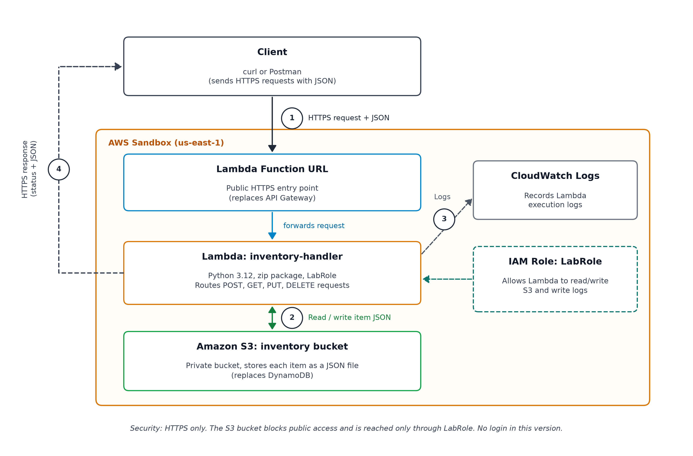
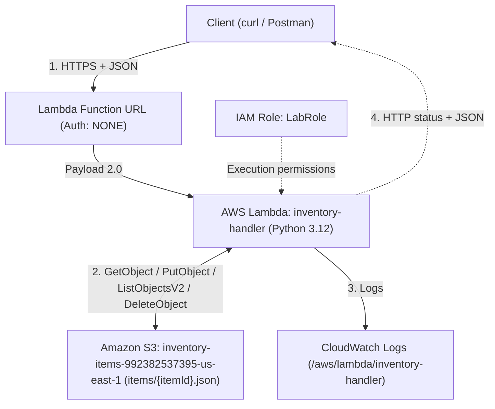

# Serverless Inventory API

AWS Cloud Computing — Week 12 Individual Project (**Track C: Serverless**)  
**Author:** Arnold Gavrael Bonardo Situmorang (`24/539797/TK/59872`)  
**Live HTTPS Endpoint:** `https://rv2twgddlrfmlyge5ulx6sv7yq0nzuzt.lambda-url.us-east-1.on.aws/`

A serverless REST-style CRUD API for managing laboratory equipment and supplies inventory, built with **AWS Lambda Function URL**, **AWS Lambda (Python 3.12)**, **Amazon S3**, and **IAM `LabRole`** in `us-east-1` (AWS Account `9923-8253-7395`).

---

## Why Different Services Were Used (AWS Academy Sandbox Adaptation)

The initial design targeted **API Gateway + AWS Lambda + Amazon DynamoDB**. During live provisioning in the **AWS Academy Cloud Foundations Sandbox** (`us-east-1`, Account `9923-8253-7395`, role `voclabs`), two services were blocked by sandbox IAM policies:

1. **API Gateway (`403 Access denied to apigateway:PUT`)** → Replaced with **AWS Lambda Function URL** (`AuthType: NONE`), providing a managed public HTTPS endpoint (`*.lambda-url.us-east-1.on.aws`) with identical Payload Format 2.0 HTTP events.
2. **Amazon DynamoDB (`400 not authorized to perform: dynamodb:CreateTable`)** → Replaced with **Amazon S3** (`inventory-items-992382537395-us-east-1`) storing one JSON document per item (`items/{itemId}.json`), preserving serverless pay-per-use object storage and direct `itemId` lookup with zero server maintenance.
3. **Custom IAM Roles (`iam:CreateRole` unavailable)** → Reused the pre-provisioned **`LabRole`** (`arn:aws:iam::992382537395:role/LabRole`).

Full verbatim sandbox denial errors and screenshots are documented in [`evidence/aws-evidence.md`](evidence/aws-evidence.md) and [`docs/design-brief.md`](docs/design-brief.md).

---

## Architecture





---

## Week 12 Deliverables & Repository Structure

| Deliverable | Files |
|---|---|
| **1. Architecture Diagram** | [`docs/architecture-diagram.png`](docs/architecture-diagram.png), [`docs/architecture-diagram.svg`](docs/architecture-diagram.svg) |
| **2. Design Brief (1–2 pages)** | [`docs/design-brief.pdf`](docs/design-brief.pdf) (2 pages), [`docs/design-brief.md`](docs/design-brief.md) |
| **3. Git Repository & Starter Code** | [`src/lambda_function.py`](src/lambda_function.py), [`tests/test_lambda_function.py`](tests/test_lambda_function.py), [`docs/deployment-plan.md`](docs/deployment-plan.md), [`scripts/test_api.ps1`](scripts/test_api.ps1) |
| **4. AWS Evidence & Test Outputs** | [`evidence/aws-evidence.md`](evidence/aws-evidence.md), [`evidence/curl-test-output.txt`](evidence/curl-test-output.txt), [`evidence/screenshots/`](evidence/screenshots) |

---

## Deployed AWS Resources (`us-east-1`)

| Resource | Identifier / ARN / URL |
|---|---|
| **Lambda Function** | `inventory-handler` (`arn:aws:lambda:us-east-1:992382537395:function:inventory-handler`, Python 3.12, `x86_64`) |
| **Lambda Function URL** | `https://rv2twgddlrfmlyge5ulx6sv7yq0nzuzt.lambda-url.us-east-1.on.aws/` (`AuthType: NONE`) |
| **Amazon S3 Bucket** | `inventory-items-992382537395-us-east-1` (`arn:aws:s3:::inventory-items-992382537395-us-east-1`, private, SSE-S3) |
| **IAM Execution Role** | `arn:aws:iam::992382537395:role/LabRole` |

---

## Data Entity (`Item`)

Stored at S3 key `items/{itemId}.json`:

| Attribute | Type | Description |
|---|---|---|
| `itemId` | String | Unique UUID v4 generated by Lambda |
| `name` | String | Name of the item (required, non-empty string) |
| `stock` | Number | Units in stock (non-negative integer, default `0`) |
| `location` | String | Storage location (optional string, default `""`) |

---

## CRUD API Endpoints

| Method | Path | Action | Success Status |
|---|---|---|---|
| `GET` | `/` | Health & endpoint summary | `200 OK` |
| `POST` | `/items` | Create item | `201 Created` |
| `GET` | `/items` | List all items | `200 OK` |
| `GET` | `/items/{id}` | Get item by ID | `200 OK` |
| `PUT` | `/items/{id}` | Update `name`, `stock`, and/or `location` | `200 OK` |
| `DELETE` | `/items/{id}` | Delete item by ID | `200 OK` |

Invalid JSON or invalid input fields return **`400 Bad Request`**; unknown IDs or routes return **`404 Not Found`**.

### Example `curl` Usage

```bash
BASE_URL="https://rv2twgddlrfmlyge5ulx6sv7yq0nzuzt.lambda-url.us-east-1.on.aws"

# Create an item
curl -s -X POST "$BASE_URL/items" \
  -H "Content-Type: application/json" \
  -d '{"name":"Oscilloscope Tektronix TBS1052C","stock":4,"location":"Lab A - Rack 2"}'

# List items
curl -s "$BASE_URL/items"

# Update stock and location
curl -s -X PUT "$BASE_URL/items/<itemId>" \
  -H "Content-Type: application/json" \
  -d '{"stock":7,"location":"Lab A - Bench 5"}'

# Delete an item
curl -s -X DELETE "$BASE_URL/items/<itemId>"
```

---

## Running Tests

### Local Unit Tests (no AWS credentials required)

```powershell
python -m unittest discover -s tests -v
```

### Live End-to-End API Verification

```powershell
powershell -ExecutionPolicy Bypass -File .\scripts\test_api.ps1 `
  -BaseUrl "https://rv2twgddlrfmlyge5ulx6sv7yq0nzuzt.lambda-url.us-east-1.on.aws"
```
