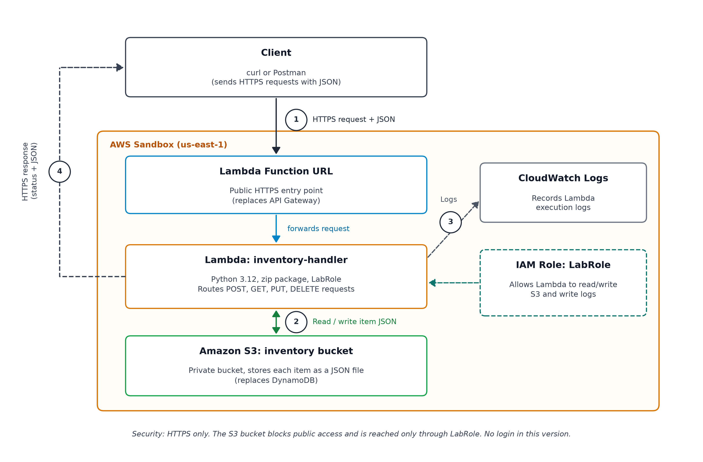

# Serverless Inventory API: Design Brief

**Name:** Arnold Gavrael Bonardo Situmorang (`24/539797/TK/59872`)  
**Repository:** `github.com/Cyphare/aws`

---

## 1. Use Case

The project is an inventory service for equipment or supplies, for example items kept in a lab. A user can add an item, list the items, view one item, change an item's stock or location, and delete an item.

A simple cloud API fits a small lab because stock counts and storage locations stay in one place instead of separate spreadsheets. Requests that omit required fields or send invalid numbers are rejected right away so the stored inventory stays clean.

## 2. Chosen Track: Serverless

This project uses **Track C: Serverless** in AWS region `us-east-1`. Serverless means AWS runs and manages the servers, and I only provide code and configuration. I am charged for requests and run time, which suits an API with very little traffic, and there is no operating system or database server to maintain. The trade-offs are less control over the environment, a 15-minute limit on one Lambda run, and a slower first request after a quiet period.

My original plan used API Gateway, Lambda, and DynamoDB. When I tried creating them in the AWS Academy sandbox, the sandbox rejected both API Gateway and DynamoDB, and did not allow creating custom IAM roles. To keep the serverless setup working without managing virtual machines, I replaced those services with the available equivalents:

| Original Plan | Replacement | Impact |
|---|---|---|
| API Gateway HTTP API | Lambda Function URL | Still uses HTTPS, but without an API Gateway route table, so URL routing is handled in Python code. |
| DynamoDB (`InventoryItems`) | Amazon S3 private bucket | Each item is stored as its own JSON file under `items/`. Simple lookup by ID works the same way, while listing reads each file. |
| Custom IAM role | Existing `LabRole` | The sandbox blocks creating new roles, so Lambda uses the pre-made `LabRole`. |

## 3. Architecture Diagram

## 4. Components and Why Each Is Used

| Component | What It Does | Why It Is Used |
|---|---|---|
| Client (`curl` / Postman) | Sends HTTPS requests with JSON bodies. | Easy way to test all API routes without building a front end. |
| Lambda Function URL | Public HTTPS entry point that forwards requests to `inventory-handler`. | Lambda cannot be called directly from outside AWS without an HTTP trigger; replaces API Gateway. |
| Lambda (`inventory-handler`, Python 3.12) | Reads the HTTP method and path, checks JSON inputs, and runs CRUD actions on S3. | Compute without a server. One function handles all routes, keeping the setup small. |
| Amazon S3 (private inventory bucket) | Stores each item as `items/<itemId>.json` with public access blocked and default encryption on. | Durable, serverless storage that replaces DynamoDB while keeping key-based item lookup. |
| IAM role (`LabRole`) | Gives Lambda permission to read and write S3 and write logs. | Lambda has no access to other AWS services by default, and the sandbox provides `LabRole`. |
| CloudWatch Logs | Records Lambda execution and error logs. | Helps verify requests and debug errors after deployment. |

## 5. Data Entity

One entity, **Item**, stored as a JSON file named after its `itemId` inside the `items/` folder of the S3 bucket. Lambda generates `itemId` as a UUID string.

| Attribute | Type | Description |
|---|---|---|
| `itemId` | String | Unique item key (UUID generated by Lambda) |
| `name` | String | Name of the item (required) |
| `stock` | Number | Units in stock (default = `0`) |
| `location` | String | Where the item is kept (optional, default = `""`) |

## 6. CRUD Endpoints

| Operation | Method | Path | Success | Error |
|---|---|---|---|---|
| Health check | `GET` | `/` | `200` | `404` |
| Create item | `POST` | `/items` | `201` | `400` |
| List items | `GET` | `/items` | `200` | — |
| Get one item | `GET` | `/items/{id}` | `200` | `404` |
| Update item | `PUT` | `/items/{id}` | `200` | `400`, `404` |
| Delete item | `DELETE` | `/items/{id}` | `200` | `404` |

Invalid JSON, missing `name`, or negative `stock` returns `400`. An unknown item ID or unknown path returns `404`.

## 7. IAM, Network, and Security

- The Function URL accepts HTTPS requests only.
- The S3 bucket blocks all public access and encrypts objects at rest, so nobody on the internet can read the files directly.
- Lambda accesses S3 and CloudWatch Logs only through `LabRole`, with no access keys stored in code. No VPC is needed because Lambda and S3 are managed AWS services.
- There is no login or API key in this version, so anyone with the URL can call the API. Outside the sandbox, this would be improved by adding an authorizer or API key and replacing `LabRole` with a minimal role limited to this one bucket.
