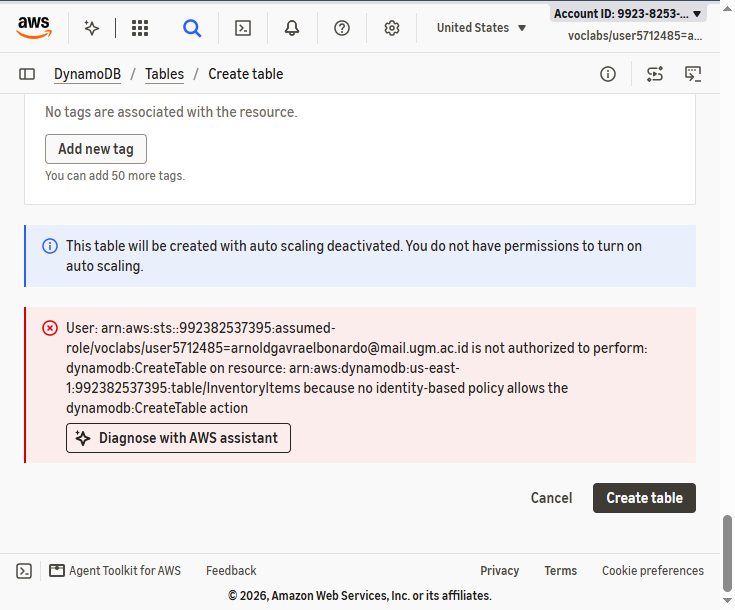
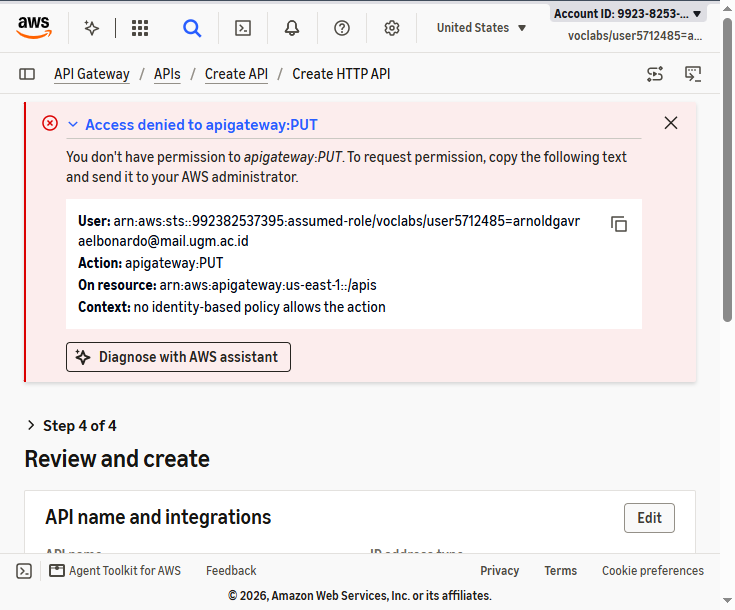
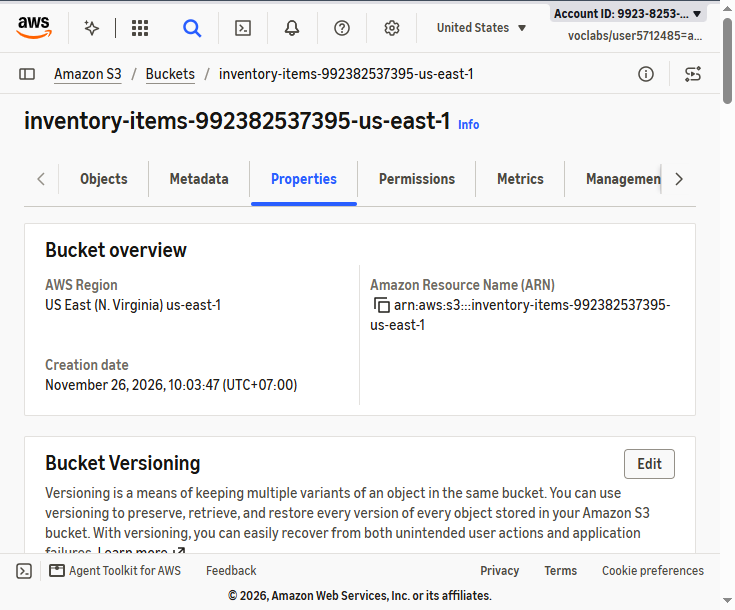
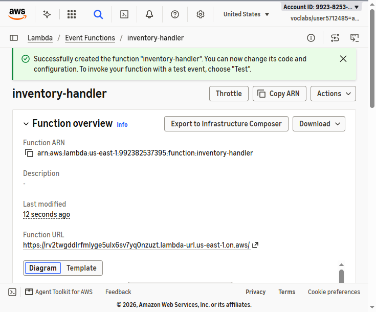
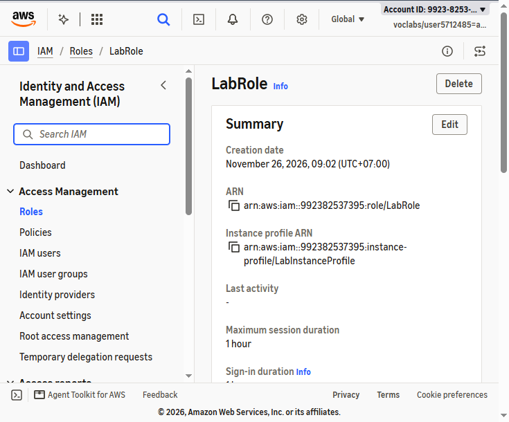
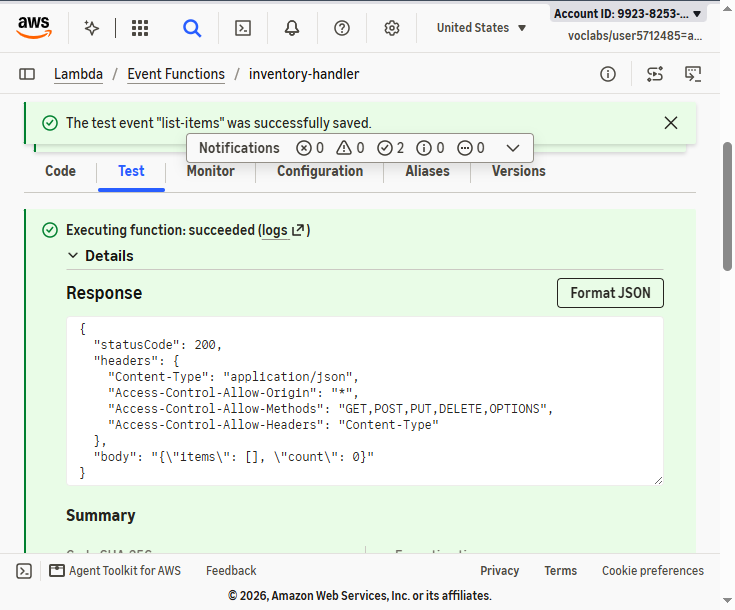
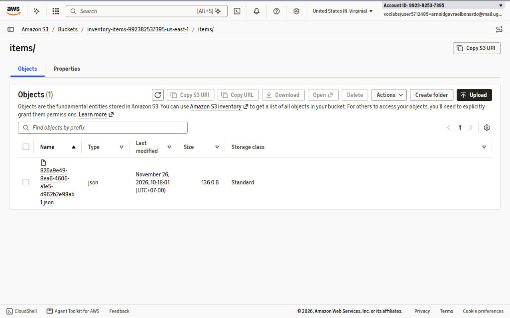

# AWS Deployment & Verification Evidence

**Project:** Serverless Inventory API (Week 12 — Track C: Serverless)  
**Author:** Arnold Gavrael Bonardo Situmorang – `24/539797/TK/59872`  
**Verification Date:** November 26, 2026 (`UTC+07:00`)

---

## 1. Live Deployment Metadata

| Item | Verified Value |
|---|---|
| **AWS Account ID** | `9923-8253-7395` |
| **AWS Region** | `us-east-1` (US East — N. Virginia) |
| **Federated Sandbox Role** | `arn:aws:sts::992382537395:assumed-role/voclabs/user5712485=arnoldgavraelbonardo@mail.ugm.ac.id` |
| **Live Public HTTPS Endpoint** | `https://rv2twgddlrfmlyge5ulx6sv7yq0nzuzt.lambda-url.us-east-1.on.aws/` |
| **Lambda Function** | `inventory-handler` (`Python 3.12`, `x86_64`) |
| **Lambda Function ARN** | `arn:aws:lambda:us-east-1:992382537395:function:inventory-handler` |
| **Amazon S3 Bucket** | `inventory-items-992382537395-us-east-1` (Private, SSE-S3) |
| **Amazon S3 Bucket ARN** | `arn:aws:s3:::inventory-items-992382537395-us-east-1` |
| **Lambda Execution Role** | `arn:aws:iam::992382537395:role/LabRole` |

---

## 2. Sandbox Service Availability & Why Substitutions Were Made

During initial provisioning in the AWS Academy Cloud Foundations Sandbox (`Sandbox Lingkungan Hidup`), two services from the original design were explicitly blocked by IAM policies on `voclabs`:

| Service | Status | Exact Verified Outcome / Error | Architectural Decision |
|---|---|---|---|
| **API Gateway (HTTP API)** | **Unavailable** | HTTP `403`: `Access denied to apigateway:PUT` on `arn:aws:apigateway:us-east-1::/apis` (`no identity-based policy allows the action`). | Replaced with **Lambda Function URL** (`AuthType: NONE`) to preserve a managed HTTPS endpoint with Payload Format 2.0. |
| **Amazon DynamoDB** | **Unavailable** | HTTP `400`: `not authorized to perform: dynamodb:CreateTable on resource: arn:aws:dynamodb:us-east-1:992382537395:table/InventoryItems because no identity-based policy allows the dynamodb:CreateTable action`. (`application-autoscaling:PutScalingPolicy` also denied.) | Replaced with **Amazon S3** storing one JSON document per item (`items/{itemId}.json`) in a private SSE-S3 bucket. |
| **IAM Role Creation** | **Restricted** | `iam:CreateRole` unavailable; `iam:GetRole` on `voclabs` denied. | Reused pre-existing **`LabRole`** (`iam:PassRole` allowed). |
| **AWS Lambda + Function URL** | **Available** | Created `inventory-handler` (`Python 3.12`), uploaded `.zip`, enabled Function URL (`AuthType: NONE`). | Core serverless compute and HTTPS entry point. |
| **Amazon S3** | **Available** | Created private bucket `inventory-items-992382537395-us-east-1` and verified CRUD via `LabRole`. | Core serverless data store. |
| **CloudWatch Logs** | **Available** | Execution log streams written automatically during Lambda tests. | Execution observability. |

---

## 3. AWS Console Screenshots

### 3.1 Denied Original Services (Why Substitutions Were Needed)

- **DynamoDB `CreateTable` Access Denied:**  
  

- **API Gateway `apigateway:PUT` Access Denied:**  
  

### 3.2 Provisioned Serverless Stack & IAM Role

- **Amazon S3 Bucket (`inventory-items-992382537395-us-east-1`) Overview:**  
  

- **AWS Lambda (`inventory-handler`) Overview & Live Function URL:**  
  

- **IAM Execution Role (`LabRole`):**  
  

### 3.3 Live Console Test & S3 Object Persistence

- **AWS Lambda Console Test (`list-items` → `Succeeded`, `statusCode: 200`):**  
  

- **Amazon S3 Objects Prefix (`items/826a9e49-8ea6-4606-a1e5-d962b2e98ab1.json`, `136.0 B`):**  
  

---

## 4. Live HTTPS `curl.exe` Verification Summary

Executed via [`scripts/test_api.ps1`](../scripts/test_api.ps1) against `https://rv2twgddlrfmlyge5ulx6sv7yq0nzuzt.lambda-url.us-east-1.on.aws`. Full verbatim HTTP responses are saved in [`evidence/curl-test-output.txt`](curl-test-output.txt).

| # | Test Case | Method & Path | Expected | Observed | Result Summary |
|---|---|---|---|---|---|
| 1 | Health check | `GET /` | `200` | `200` | `{"service":"Serverless Inventory API","storage":"Amazon S3","status":"ok",...}` |
| 2 | Initial empty list | `GET /items` | `200` | `200` | `{"items": [], "count": 0}` |
| 3 | Create item 1 | `POST /items` | `201` | `201` | Created `826a9e49-8ea6-4606-a1e5-d962b2e98ab1` (`Oscilloscope Tektronix TBS1052C`, `stock: 4`) |
| 4 | Create item 2 | `POST /items` | `201` | `201` | Created `650241ac-dcbd-4e17-b6e6-cb74607a1c5d` (`Digital Multimeter Fluke 117`, `stock: 10`) |
| 5 | Validation error (empty body `{}`) | `POST /items` | `400` | `400` | `{"error": "Field 'name' is required and must be a non-empty string"}` |
| 6 | List after creates | `GET /items` | `200` | `200` | Returned `count: 2` with both created items |
| 7 | Update item 1 stock & location | `PUT /items/826a9e49-...` | `200` | `200` | Updated to `stock: 7`, `location: "Lab A - Bench 5"` |
| 8 | Update nonexistent item | `PUT /items/nonexistent-id-000` | `404` | `404` | `{"error": "Item not found", "itemId": "nonexistent-id-000"}` |
| 9 | Delete item 2 | `DELETE /items/650241ac-...` | `200` | `200` | `{"deleted": true, "itemId": "650241ac-dcbd-4e17-b6e6-cb74607a1c5d"}` |
| 10 | Delete nonexistent item | `DELETE /items/nonexistent-id-000` | `404` | `404` | `{"error": "Item not found", "itemId": "nonexistent-id-000"}` |
| 11 | Final persistence list | `GET /items` | `200` | `200` | Returned `count: 1` with updated Oscilloscope item persisted in S3 |
